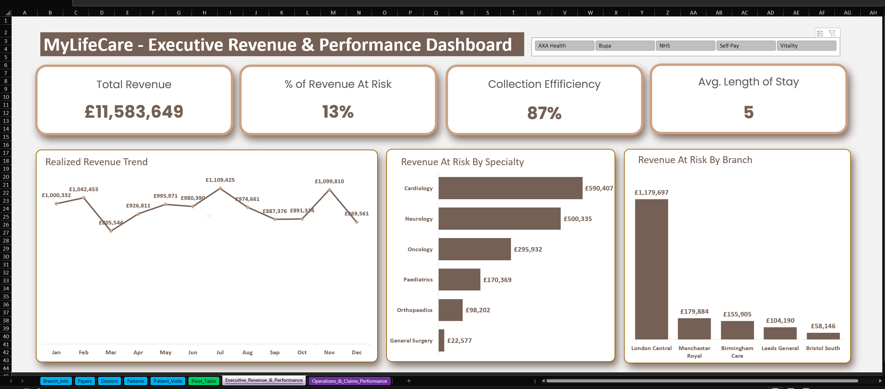
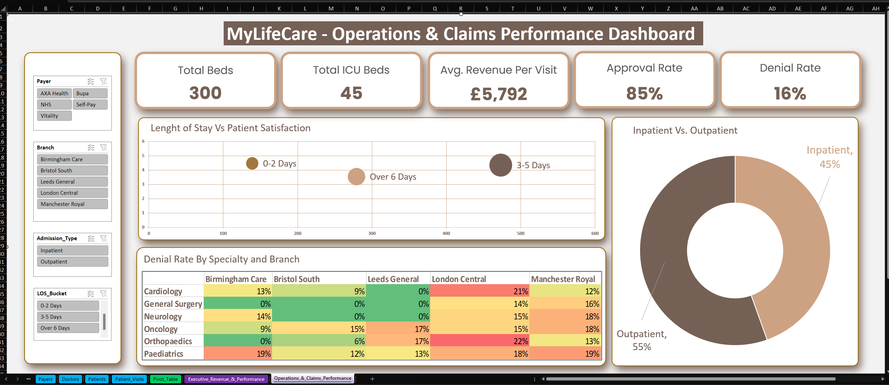

# Overview

MyLifeCare UK Hospital Group is a multi-branch healthcare provider operating across five major English cities: London, Manchester, Birmingham, Leeds and Bristol. It delivers inpatient and outpatient care across six specialties: Cardiology, Oncology, Neurology, Orthopaedics, General Surgery and Paediatrics.
 

# Business Problem
MyLifeCare UK Hospital Group has two years of operational and financial data across five branches, but it sits in multiple uncleaned sheets and has never been integrated into a form leadership can use. The group handles a high volume of inpatient and outpatient visits across six specialties, funded by a mix of NHS and private insurance. Even so, it has no clear view of billing accuracy, revenue performance, payer efficiency, financial risk or operational strain at branch level. Without a centralised performance monitoring system, leadership relies on manual reports that cannot answer key management questions quickly or reliably. As a result, decision-makers cannot see how the group is actually performing, or where the revenue and payer risks are, when fast and trustworthy insight matters most.

# Objective

The objective is to to clean, transform and structure the dataset, then build PivotTables that summarise financial, operational and payer performance. This includes calculated fields for indicators such as approval rate and revenue at risk. The results will be presented as dashboard visuals with interactive slicers, forming an executive-ready dashboard.

## Datasource

The dataset used in this project was a simulated healthcare dataset structured around a hospital scenario. It reflects real-world data patterns and includes details on:
- Patient demographics and visit history
- Admission and appointment status
- Departmental allocation and doctor assignments
- Treatment types, diagnoses, and outcomes
- Readmission flags and visit duration metrics

> [!WARNING]
> Note: This dataset is fictional and intended for portfolio purposes only. No real customer data is used.

## Tools and Technology

- **Excel:** Used for Preparation and Cleaning
- **Power BI Desktop:**	Data modeling, dashboard creation
- **Power Query:**	Data transformation and cleaning
- **DAX:**	Business logic and KPIs
- **Star Schema:** Modeling	Scalable, optimized data architecture
- **Power BI Service:**	For live publishing, sharing, and cloud-based report consumption

# Analytical Approach

The dashboard is structured into three key analytical layers, each designed to answer specific operational and strategic questions within the hospital.

**Analysis Performed**

 
 

 
 

**Executive Analytics**
- What’s the realized revenue, and how does it trend over time?
- What the revenue at risk by Specialty and Branch?

  
**Key Insights**
- Total realized revenue is £11,58M, averaging about £965K a month.
- It peaked in July (£1.11M) and November (£1.10M), dipped to £806K in March, and fell to £870K in December.
- £1.68M is at risk in total. Cardiology (35%) and Neurology (30%) account for 65% of it.
- London Central holds about 70% (£1.18M), far above every other branch. Bristol South is lowest at £58K.

# ADD RECOMMENDATION
_______________________________________________________________________________
 
 

 
 

**Operation and Claim Analytics**
- What is the percentage of Inpatient and Outpatient?
- How does length of stay affect patient satisfaction?
- Which specialties and branches have the highest denial rates?

**Key Insights**
- Outpatients are 55% and inpatients 45%, so the mix is fairly balanced with a slight outpatient lean.
- Satisfaction appears lowest for stays over 6 days and higher for shorter stays.
- London Central is highest, with Orthopaedics at 22% and Cardiology at 21%. It is also the branch with the most revenue at risk. 
Paediatrics is high at every branch (12–19%).  
Leeds General has 0% denials in three specialties, and General Surgery is at 0% in three branches.

# ADD RECOMMENDATION
____________________________________________________________________________

